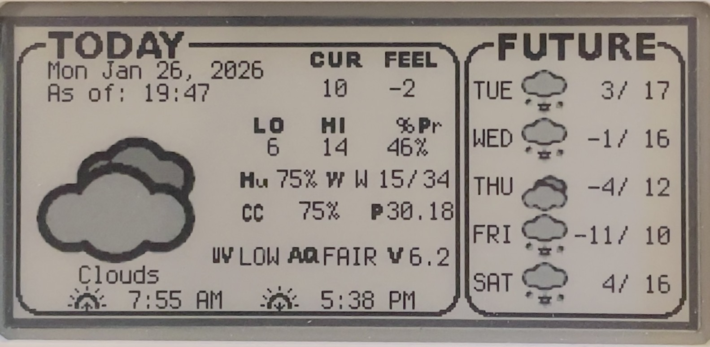

# SBMagtag-Weather
My version of the Adafruit Magtag weather display.  This pulls from OpenWeatherMaps API for the latest forecast data and displays it on an epaper display on my fridge.  Its a work in progress thats for sure.  

I modified the original program to how it made sense for me, and added many sections to display more data.  The screen is pretty dense, as you can see below:

